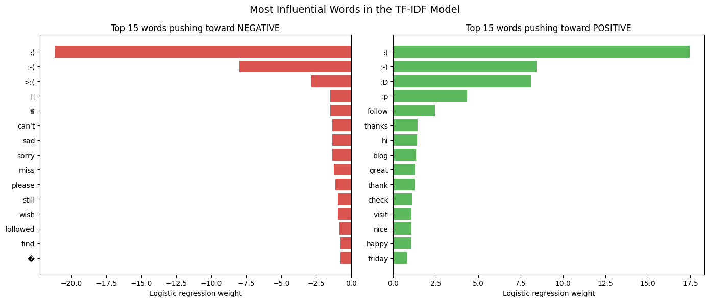

# Sentiment Analysis on Tweets

Classifying 10,000 tweets as positive or negative with logistic regression, comparing **Bag-of-Words**, a **2-feature sentiment-frequency** representation and **TF-IDF**, and then digging into *why* every model scores around 99%.

📓 **Notebook:** [`tweet_sentiment_analysis.ipynb`](tweet_sentiment_analysis.ipynb)

---

## The problem

- **Data:** NLTK `twitter_samples`, 5,000 positive + 5,000 negative tweets, split 70/30 (7,000 train / 3,000 test, stratified).
- **Goal:** compare feature representations for logistic regression, and understand what the models actually learn.

## Approach

1. **Preprocessing** (`utils.py`): remove tickers, retweet markers, URLs and `#`; tokenize with NLTK's `TweetTokenizer` (keeps emoticons, strips handles, shortens stretched words); remove stopwords and punctuation; lemmatize with WordNet.
2. **Three feature representations:**

| Approach | Features per tweet | How |
|---|---|---|
| Bag-of-Words | 9,197 word counts | one column per training-vocabulary word |
| Sentiment frequencies | 3 (bias, Σ positive frequencies, Σ negative frequencies) | look up each word's counts in positive and negative training tweets |
| TF-IDF | 9,197 weights | `TfidfVectorizer` with the same tokenizer, fit on training tweets only |

3. **Logistic regression** with identical settings for every representation, so only the features differ.
4. **Evaluation** with F1 and Jaccard (IoU), plus error counts.
5. **Error analysis:** feature importance, misclassified tweets compared across models, custom test tweets, and each model's default guess on an empty tweet.

## Results

| Approach | F1 | Jaccard | Errors (of 3,000) |
|---|---|---|---|
| Bag-of-Words | 0.9947 | 0.9894 | 16 |
| Sentiment frequencies (2 features) | 0.9927 | 0.9855 | 22 |
| **TF-IDF** | **0.9967** | **0.9934** | **10** |

TF-IDF made the fewest errors, and they were balanced between the classes (Bag-of-Words was biased toward predicting "positive"). The 2-feature model came remarkably close with just two numbers per tweet.

## Key findings

**1. The models are mostly emoticon detectors.**
The five most influential features are all emoticons (`:(` weight −21.2, `:)` +17.5), far above any real word. This dataset was **labelled using emoticons**, so the label is nearly readable from the tweet, and ~99% accuracy overstates how well the models understand sentiment. This is a classic case of shortcut learning.



**2. A spam account taught the model that a crown emoji is negative.**
"♛" ranked as a strong negative feature even though it's positive in slang ("queen"). Tracing it in the data: one fan posted nearly the same tweet over and over ("I LOVE YOU SO MUCH… PLEASE FOLLOW ME… :("), **27 copies in training and 8 in test**, all labelled negative because of the sad emoticon. The duplicates also make the test score look better than it is.

**3. Error patterns across all three models:**
- **Unrecognized emoticons:** most errors contain `: (` with a space or variants like `(:(`, which the tokenizer doesn't recognize, so the model loses its strongest clue.
- **Default positive guess:** on an empty tweet, Bag-of-Words predicts 72% positive and the sentiment model 75%, so tweets like "Who made this stupid movie?" come out positive.
- **Wrong labels:** some "errors" are mislabelled tweets, such as a job posting labelled negative.
- **Negation is erased:** the stopword list includes "not", so "not good" becomes "good" before the model sees it.
- **Repetition:** Bag-of-Words grows more confident with "great great great great"; TF-IDF's normalization gives all repetitions the same score.

## What I'd improve

- Keep negation words, or add word pairs (bigrams) such as "not good".
- Normalize emoticon variants before tokenizing.
- Remove duplicated and mislabelled tweets.
- Retrain without emoticons to measure real sentiment understanding.
- Context-aware models (embeddings or transformers) for sarcasm and phrases.

## Running it

```bash
pip install -r requirements.txt
jupyter notebook tweet_sentiment_analysis.ipynb
```

Keep `utils.py` in the same folder as the notebook. The NLTK data (tweets, stopwords, WordNet) is downloaded automatically.

## Tech stack

Python · NLTK · scikit-learn · NumPy · pandas · Matplotlib / Seaborn
